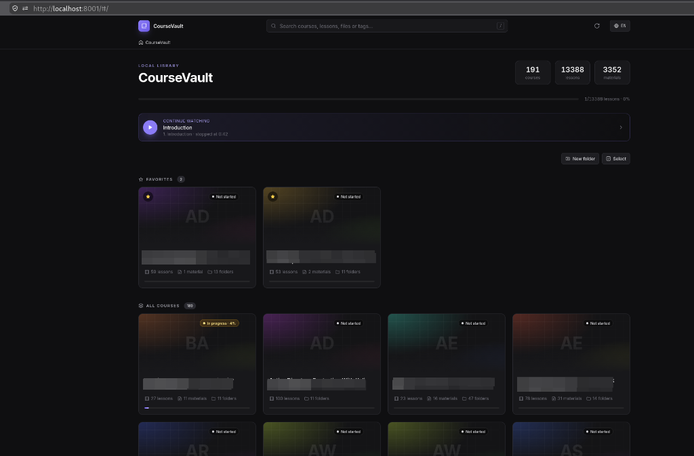

# CourseVault

*[Read in English](README.md)*

Portal local (estilo Obsidian, dark mode) para navegar pela sua pasta de cursos e laboratórios:
cards por curso, tags clicáveis, busca instantânea, player de vídeo com seek suave,
progresso por aula e pré-visualização de PDFs, Markdown e código.

Sem banco de dados e sem build de Node: um `server.py` (FastAPI) + um `index.html`
(Tailwind via CDN + JavaScript puro). A interface está em **português e inglês**: use o botão
de idioma no canto superior direito.



## Instalação

Requer Python 3.9+.

```bash
python3 -m venv .venv
source .venv/bin/activate          # Windows: .venv\Scripts\activate
pip install -r requirements.txt    # = pip install fastapi uvicorn
```

## Como iniciar

```bash
# a partir da pasta raiz dos cursos
cd ~/Cursos
python /caminho/para/server.py

# ou apontando a raiz explicitamente
python server.py --root ~/Cursos
```

O navegador abre em `http://localhost:8000`.

| Opção | Descrição |
|---|---|
| `-r, --root PASTA` | Pasta raiz dos cursos (padrão: pasta atual, ou `$HUB_ROOT`) |
| `-p, --port 8000` | Porta HTTP |
| `--host 0.0.0.0` | Expõe na LAN (ex.: assistir no tablet). O padrão `127.0.0.1` só aceita acesso local |
| `--no-browser` | Não abre o navegador automaticamente |
| `--follow-symlinks` | Permite links simbólicos que apontam para fora da raiz (ex.: cursos em um HD externo). Esses itens ficam somente leitura |
| `--allow-host NOME` | Com `--host 0.0.0.0`: nome extra aceito no header `Host` (repetível). IPs e o nome da própria máquina sempre funcionam |
| `--ttl 30` | Segundos de cache do índice de busca e das contagens recursivas |
| `--read-only` | Desativa toda a edição (capa, criar, renomear, mover e excluir) |

Se o `server.py` ficar dentro da própria pasta de cursos, os arquivos do app ficam ocultos no hub.

### Atalho `cursos.sh`

O `cursos.sh` inicia o servidor com a `.venv` do projeto, `--follow-symlinks` e uma pasta padrão.
Crie um link num diretório do seu `PATH`:

```bash
ln -s "$PWD/cursos.sh" ~/.local/bin/cursos
cursos                      # pasta padrão ($COURSEVAULT_ROOT)
cursos ~/Downloads/curso    # qualquer pasta
cursos . --port 9000        # opções extras vão para o server.py
```

O script encontra o projeto pelo link, então continua funcionando se a pasta do projeto mudar de lugar.

## Idioma

Na primeira visita a interface segue o idioma do navegador (português para `pt-*`, inglês para o resto).
O botão **PT/EN** no canto superior direito troca o idioma, e a escolha fica salva no navegador.
As mensagens de erro do servidor seguem o mesmo idioma. A linha de comando (`--help`, mensagens de
início, `cursos.sh`) segue o `LANG` do sistema.

## Configuração por pasta (`course.conf`)

Opcional, em qualquer pasta. Também é lido como `.course.conf` ou `.conf`.
Veja `course.conf.example`:

```ini
pinned = true
banner = banner.jpg            # imagem dentro da pasta ou da biblioteca, ou URL externa
tags = Active Directory, Pentest, Windows, Kerberos
title = Active Directory Exploitation
description = Anotações e aulas sobre exploração em ambientes AD.
```

Campos extras: `status`, `color`, `order`, `hidden`, `banner_pos` (enquadramento vertical da capa, 0–100)
e `banner = none` (sem capa). Sem `banner`, o app procura `banner.*`, `cover.*` ou `capa.*` na pasta e,
se não houver, gera um gradiente.
Um `course.conf` na raiz define o título do hub (`title = Meus Cursos`).

## Funcionalidades

- **Dashboard:** seção de favoritos, grid de cards (capa, título, contagem de aulas/materiais/pastas, tags, status), filtro por tags (mais de uma tag combina com E), e um atalho "Continuar assistindo".
- **Navegação:** breadcrumbs, pills para pastas irmãs, módulos (subpastas) com progresso. As URLs ficam no hash (`#/Curso/Modulo?play=aula.mp4`), então voltar, avançar e favoritos funcionam.
- **Vídeos** (`.mp4 .mkv .webm .mov .m4v`) e áudios: lista com título limpo (`03 - Kerberoasting_avancado.mp4` vira **03** Kerberoasting avancado). O player só é criado quando você clica (um vídeo por vez) e traz PiP, tela cheia, velocidade, anterior/próxima, autoplay da próxima e retomada de onde parou. A aula é marcada como assistida aos 90%. Legendas `.srt`/`.vtt` com o mesmo nome (`aula.pt-BR.srt`) são carregadas automaticamente.
- **Materiais:** PDF no visualizador do navegador; código (`.asm .py .sh .c .ps1 …`) com syntax highlighting e numeração de linhas; Markdown renderizado (com imagens relativas); botões de copiar, abrir em nova aba e baixar.
- **Busca** (`/` ou `Ctrl+K`): ignora acentos e maiúsculas e procura em pastas, aulas, arquivos e tags. Dá para restringir à pasta atual. `Enter` abre o primeiro resultado e as setas navegam.
- **Favoritos:** a estrela nos cards, nos módulos e no cabeçalho da pasta favorita qualquer pasta. As favoritas (e as com `pinned = true`) aparecem primeiro na raiz, nos módulos e nas pills de pastas irmãs.
- **Editar capa:** o botão "Editar capa" no cabeçalho de uma pasta permite enviar uma imagem (escolher, arrastar ou colar com Ctrl+V), usar uma URL, remover a capa e ajustar o enquadramento vertical. A imagem é salva como `banner.<ext>` na pasta e o `course.conf` é atualizado. A capa anterior não é apagada: vira `.<nome>.bak`, oculto no hub.
- **Organizar pastas e arquivos:** cada pasta, aula e arquivo tem um menu ⋯ com **Renomear**, **Mover para…** e **Excluir**. "Nova pasta" e "Selecionar" ficam no topo da raiz e no cabeçalho de cada pasta. No modo seleção, clique nos itens e use a barra de baixo para mover ou excluir vários de uma vez. "Mover para…" abre um navegador de pastas, com busca em toda a biblioteca e opção de criar a pasta de destino ali mesmo. Legendas com o mesmo nome do vídeo acompanham o vídeo ao renomear, mover e excluir. O progresso, os favoritos e o "Continuar assistindo" seguem os itens para o novo caminho. Nada é sobrescrito: se já existir um item com o mesmo nome no destino, a operação para.
- **Lixeira:** "Excluir" não apaga nada. O item vai para `.lixeira/<data_hora>/<caminho original>` na raiz dos cursos (oculta no hub). Para restaurar, mova o item de volta pelo gerenciador de arquivos; para liberar espaço de vez, apague a pasta `.lixeira`.
- **Progresso e favoritos:** ficam salvos no `localStorage` do navegador. O app só mexe nas suas pastas quando você pede: editar a capa (`banner.*` e `course.conf`) ou criar, renomear, mover e excluir itens.

## Segurança

- Escuta só em `127.0.0.1` por padrão e rejeita `Host` desconhecido (proteção contra DNS rebinding). No modo LAN (`--host 0.0.0.0`) a checagem continua: aceita IPs e o nome da própria máquina (`hostname`, `hostname.local`); outros nomes, com `--allow-host`.
- Bloqueia `../`, caminhos absolutos, arquivos ocultos (`.algo`) e symlinks para fora da raiz (a menos que você use `--follow-symlinks`). Mesmo com `--follow-symlinks`, links para arquivos ou pastas ocultas (ex.: `~/.ssh`) são recusados, e o que fica fora da raiz é somente leitura.
- O `banner` do `course.conf` só aceita imagens dentro da própria pasta ou da biblioteca.
- As rotas que gravam (`PUT`/`PATCH`/`DELETE`, os `POST` de `/api/fs/*`, que exigem JSON, e o `POST /api/refresh`) rejeitam requisições com `Origin` de outro site. Com `--host 0.0.0.0`, qualquer dispositivo da LAN também pode editar; use `--read-only` para impedir.
- Nomes com `/ \ < > : " | ? *`, começando com ponto ou terminando em ponto são recusados (compatível com NTFS). A raiz, a `.lixeira` e os arquivos do app não podem ser alterados.
- Só vídeo, áudio, imagens, PDF, legendas e texto são exibidos no navegador. Código web (`.html`, `.xhtml`, `.shtml`, `.js`, `.xml`) é servido como texto puro, SVG com CSP `sandbox` e qualquer outro tipo (ex.: `.xht`, `.svgz`, `.rss`) como download, para que nenhum material execute script na origem do app.
- Os scripts de highlight.js, marked e DOMPurify vindos do CDN são conferidos com SRI (`integrity`). O Tailwind está fixado numa versão exata, mas o CDN dele não suporta SRI.

## Observações

- **MKV:** o navegador só toca se o codec for suportado (H.264/VP9/AV1 + AAC/Opus). MKV com HEVC ou AC3 mostra um aviso com link de download para abrir no VLC/mpv.
- **Offline:** Tailwind, highlight.js e marked vêm de CDN. Sem internet o app funciona, mas sem estilo.
- **Arquivos novos** aparecem na hora na listagem. As contagens e a busca se atualizam em até `--ttl` segundos, ou na hora pelo botão ⟳ (reindexar).

## API

Todas as rotas aceitam o header `X-Lang: pt|en` (ou `Accept-Language`) para o idioma das mensagens de erro.

| Rota | Descrição |
|---|---|
| `GET /api/list?path=` | Conteúdo da pasta (subpastas com conf e contagens, mídias, materiais, breadcrumbs, irmãs) |
| `GET /api/search?q=&path=` | Busca global ou dentro de uma pasta |
| `GET/HEAD /api/file?path=[&download=1]` | Arquivo com suporte a `Range` (206 Partial Content) |
| `GET /api/banner?path=` | Capa da pasta |
| `GET /api/text?path=` | Conteúdo de texto/código (até 2 MB) |
| `GET /api/subtitle?path=` | Legenda convertida para WebVTT |
| `PUT /api/banner?path=` | Envia uma nova capa (corpo = imagem; JPG, PNG, WebP, GIF ou AVIF, até 15 MB) |
| `DELETE /api/banner?path=` | Remove a capa (`banner = none`; o arquivo vira `.bak`) |
| `PATCH /api/conf?path=` | Altera `banner` (URL http/https) e/ou `banner_pos` (0–100) no `course.conf`; JSON |
| `GET /api/tree?path=` | Subpastas de uma pasta (navegador de pastas) |
| `POST /api/fs/mkdir` | Cria uma pasta: `{parent, name}` |
| `POST /api/fs/rename` | Renomeia: `{path, name}`; devolve `moved: [{from, to}]` |
| `POST /api/fs/move` | Move vários itens: `{paths, dest}`; devolve `moved` |
| `POST /api/fs/trash` | Move para `.lixeira`: `{paths}` |
| `POST /api/refresh` | Reconstrói o índice |
| `GET /api/docs` | Documentação interativa (Swagger) |
